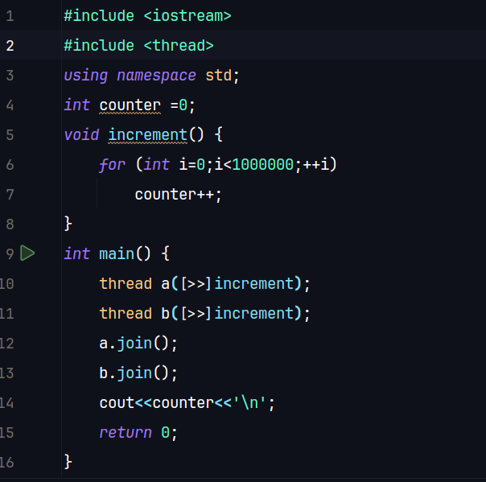

# Lock-Free-SPSC-Ring-Buffer
A high-performance lock-free Single-Producer Single-Consumer (SPSC) Ring Buffer implemented in C++ designed for efficient inter-thread communication with minimal synchronization overhead.

# Lock Free queues
1. head - insertion to the queue is made
2. tail - consumer reads from here
when we reach end of the queue --> wrap back to the beginning

# How to wrap around?
## Fast Wrap-Around
- Cant do index%size because it takes 10 - 20 CPU cycles
- WE can have the capacity as power of 2 and do bitwise AND mask
- index & (capacity -1) because AND bitwise takes 1 cycle

# Cache Coherence
- Memory is derived from RAM to l1/l2 cache in 64-byte chunks and these are called cache lines
- MESI - CPU's cache coherence protocol

# Data race that we want to prevent
1. The Code: 

2. The Output: 

- Here we can see that more than half of our progress is lost 
- This is the exact issue we are trying to solve

